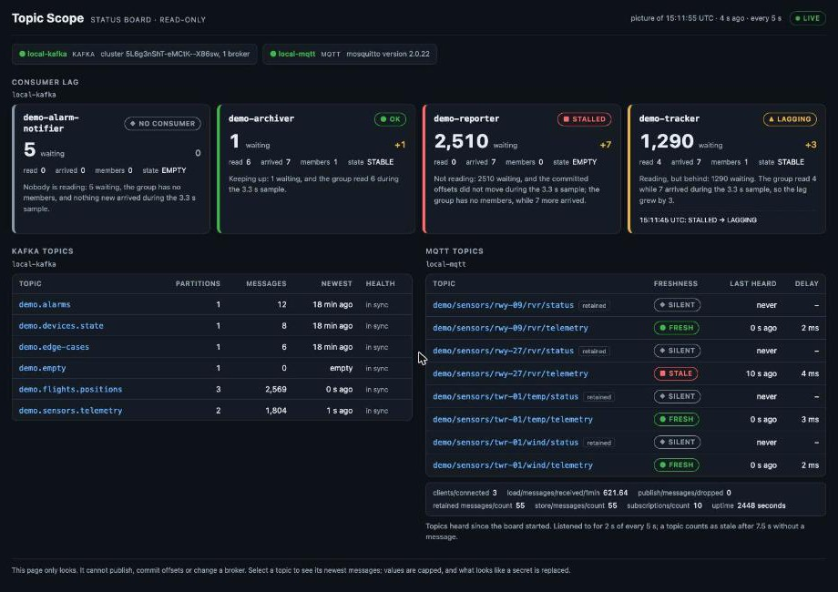
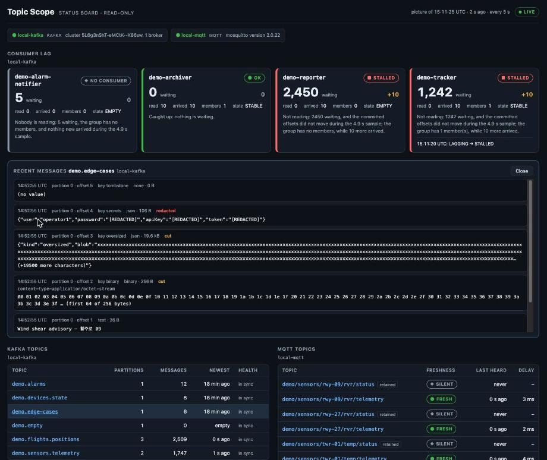

# Topic Scope MCP

A **read-only** MCP server that lets an AI assistant look inside Kafka and MQTT brokers: which topics exist, what the latest messages are, and whether consumers are keeping up.

> **Status: version 0.1.0.** Everything described here works and is tested, against Apache Kafka and Mosquitto in Docker. It is a first release by one person: read [Known limitations](#known-limitations) before pointing it at a system that matters. There is no download yet; the jar and the Docker image are built from source.

**Jump to:** [Quick start](#quick-start) · [**Usage**](docs/usage.md) ([한국어](docs/usage.ko.md)) · [What it shows](#what-it-shows) · [Tools](#tools) · [Status board](#status-board) · [Safety](#safety) · [Installation](#installation)

## Quick start

You need Java 21 and Docker.

```bash
git clone https://github.com/Trapa-Eureka/topic-scope-mcp.git
cd topic-scope-mcp
./mvnw -DskipTests install                 # the server jar
docker compose up -d --build --wait        # Kafka and Mosquitto with demo data, on this machine only
```

Start Claude Code in this folder and approve the MCP server `topic-scope` (the repository's `.mcp.json` registers it). Then ask:

- "Which brokers can you see?"
- "Which topics are on local-kafka, and is anything arriving?"
- "Is demo-tracker keeping up?"
- "Are the sensors on local-mqtt still reporting every 2 seconds?"

For the web status board instead: `docker compose --profile board up -d --build --wait`, then open http://127.0.0.1:8090.

Everything else (other clients, HTTP, Docker, your own brokers) is in the [usage guide](docs/usage.md).

## Overview

In a messaging-based system (sensors publish over MQTT, services exchange events over Kafka) the first questions during development, testing and an incident are always the same:

1. **Is the topic there?** Did the service create it, with the partitions I expect?
2. **What is actually flowing?** Show me the last few messages, not what the documentation says.
3. **Is anyone falling behind?** Which consumer has a backlog, and how old is the newest message?

Answering them today means switching between `kafka-topics.sh`, `kafka-consumer-groups.sh`, `mosquitto_sub` and a broker UI. Topic Scope MCP exposes the same answers as MCP tools, so an assistant such as Claude Code can fetch them while it is helping you debug, write a test or review a change.

It is built for safety-critical surroundings: it **cannot publish, cannot commit offsets and cannot join a consumer group**. Looking must never change what is being looked at.

## What it shows

An MCP server has no screen of its own. "The screen" is the assistant's chat: you ask a question, the assistant calls a tool, and the result is shown as a table. The [status board](#status-board) shows the same three views live on a web page.

### 1. Topic list

| | Kafka | MQTT |
|---|---|---|
| Where the list comes from | The broker's own catalog (Admin API) | **There is no catalog.** A topic exists only while messages are published to it, so the list is "topics heard while listening on a filter (default `#`) for a few seconds (default 3, 1 to 30)", plus the topics that hold a retained message |
| Columns | name, partitions, replication factor, internal or not, messages kept (end offset − start offset), time and age of newest message | topic, messages published during the window, has a retained message or not, highest QoS seen, arrival time of the newest message |
| Says clearly | under-replicated partitions, and partitions without a leader (their messages are not counted) | that the list is an observation, with the filter and the real window length; and that a topic which was silent and has no retained message is missing |

`#` does not match topics that start with `$`, such as the broker's own `$SYS` topics.

"Messages kept" is an upper bound for compacted topics and topics written with transactions, where offsets have gaps. `describe_topic` says so in its note when the topic is compacted. An empty topic has no newest message: the time is empty and the age is -1.

### 2. Recent messages

| | Kafka | MQTT |
|---|---|---|
| What "recent" means | The newest *N* records stored in the topic (default 10, at most 100), newest first, read by position without a consumer group. Over all partitions, or one partition on request | **The broker keeps no history.** `topic` is a topic or a topic filter; you get the retained message of each matching topic plus whatever is published while listening (default 3 s, 1 to 30), newest first |
| Columns | partition, offset, timestamp, key, headers, value, value format, value size, truncated or not, redacted or not | the concrete topic, arrival time, QoS, retained or not, value, value format, value size, truncated or not, redacted or not |

Both kinds of source answer with the same row shape. A field that only one of them has is -1, empty or false for the other (an MQTT message has no partition, offset, key or headers; a Kafka record has no QoS and is never "retained").
| Value display | see below | same |

How a value is shown (`valueFormat`):

| Format | When | Shown as |
|---|---|---|
| `json` | a JSON object or array | compact JSON. Numbers stay as written (`10.7130` is not rounded to `10.713`). A string longer than 500 characters inside it is shortened, so the rest of the document stays visible |
| `text` | any other valid UTF-8 without control characters | as it is |
| `binary` | everything else | hex of the first 64 bytes and the total size. The content is not interpreted |
| `none` | the record has no value (a tombstone) | empty |

Three things are applied to every value, key and header before it leaves the server:

- **Redaction.** A JSON field, a header or a `name=value` pair whose name says it holds a secret (`password`, `token`, `apiKey`, `authorization`, ...) gets `[REDACTED]` as its value. So do strings shaped like well-known keys and tokens (cloud access keys, JSON Web Tokens, private keys, `Bearer ...`), wherever they stand. This is a guess in both directions: a secret under an innocent name and in an unknown shape passes. **Treat what the tool returns as sensitive.**
- **A cap per value**: 2000 characters. What is cut is marked, and `valueBytes` tells the real size.
- **A budget per answer**: 40 000 characters of values. Once it is used up, the remaining (older) values are cut to a 200-character preview, and the note says so.

Records that arrive after the call started are not included; a busy topic would otherwise never finish.

### 3. Lag

"Lag" means **how far behind the reader is**. The two brokers measure it differently, and the tool says which one you are looking at.

| | Kafka | MQTT |
|---|---|---|
| Definition | **Consumer lag** = newest offset in a partition − offset the consumer group has committed. In messages | No offsets exist, so two substitutes: **freshness** = seconds since the last message on a topic; **delivery delay** = arrival time − timestamp inside the payload (only when the payload is JSON with a field such as `ts` or `timestamp`) |
| Columns | per group: state, members, lag, lag change, status, a one-sentence summary. Per topic: lag, lag change, messages read and messages arrived during the sample, status. Per partition: committed offset, end offset, lag | topic, last seen, expected interval, freshness, status |
| Columns (MQTT) | | topic, status, time and age of the newest message, messages during the window, retained or not, delivery delay |
| Status | `OK` / `LAGGING` / `STALLED` / `NO_CONSUMER`, see below | `FRESH` / `STALE` / `SILENT`, see [freshness](#freshness) |
| Also shown | time lag: age of the oldest message the group has not read yet | what the broker reports about itself under `$SYS` (clients connected, messages stored, messages dropped, ...) when it does |

One look cannot tell a slow consumer from a stopped one: both show a lag. So `consumer_lag` **looks twice**, a few seconds apart (`sampleSeconds`, default 5, 1 to 30), and judges each topic of the group by what moved in between:

| Status | Rule, in this order | Meaning |
|---|---|---|
| `OK` | nothing is waiting; or the committed offsets moved and what is waiting is no more than what the group read during the sample | caught up, or keeping pace |
| `LAGGING` | the committed offsets moved, and more is waiting than the group read during the sample | reading, but behind. The lag change tells whether it is falling further behind or catching up |
| `STALLED` | messages are waiting and the committed offsets did not move | not reading |
| `NO_CONSUMER` | messages are waiting, the group has no members, and nothing new arrived | a backlog nobody is working on |

A group gets the status that most needs attention among its topics. The judgement is per topic and not per partition on purpose: a slow consumer drains one partition at a time, so single partitions stand still while the group as a whole is moving.

Limits of the judgement: it is only as good as the sample. A consumer that commits less often than the sample is long looks `STALLED`; use a longer sample for those.

#### Freshness

`topic_freshness` answers "is anything still arriving?" for topics that should carry a message every `expectedIntervalSeconds` (default 60): a sensor that reports every few seconds, a heartbeat. It works on both kinds of source.

| Status | Rule |
|---|---|
| `FRESH` | the newest message is no older than one and a half expected intervals |
| `STALE` | there is a newest message, and it is older than that |
| `SILENT` | no message at all: an empty Kafka topic, or an MQTT topic on which nothing was heard |

One and a half intervals, not one: a topic that reports exactly on time would otherwise flip between fresh and stale depending on the moment it is looked at.

- **Kafka**: the broker knows the time of the newest record, so the answer is immediate. Leave `topic` out to check every topic.
- **MQTT**: the tool listens on a topic filter for `windowSeconds` (default: twice the expected interval plus one, at least 5 and at most 60 seconds). A retained message counts only if its payload says when it was made; its arrival time says nothing.

What listening cannot know: a topic that was already silent before the window started leaves no trace. **Behind a wildcard filter it is simply not listed; name it exactly and it is reported `SILENT`.** The tool says this in its note, and it warns when the window is too short for the expected interval to judge at all.

### Example

What `consumer_lag` answered for the four consumer groups of the [local stack](#local-stack-and-demo-data), which had been running with live traffic for about 45 minutes. Copied from a real run; an assistant turns this into a table or a sentence.

| Group | Status | Lag | Lag change | Read / arrived in 5.1 s | Oldest unread | Summary |
|---|---|---|---|---|---|---|
| `demo-archiver` | `OK` | 0 | 0 | 10 / 10 | – | Caught up: nothing is waiting. |
| `demo-tracker` | `LAGGING` | 2723 | +5 | 5 / 10 | 1736 s | Reading, but behind: 2723 waiting. The group read 5 while 10 arrived during the 5.1 s sample, so the lag grew by 5. |
| `demo-reporter` | `STALLED` | 5426 | +10 | 0 / 10 | 2594 s | Not reading: 5426 waiting, and the committed offsets did not move during the 5.1 s sample; the group has no members, while 10 more arrived. |
| `demo-alarm-notifier` | `NO_CONSUMER` | 5 | 0 | 0 / 0 | 2593 s | Nobody is reading: 5 waiting, the group has no members, and nothing new arrived during the 5.1 s sample. |

Kafka's own `kafka-consumer-groups.sh --describe`, run a few seconds later, showed lags of 0, 2733, 5446 and 5.

## Tools

| Tool | What it returns | Status |
|---|---|---|
| `list_sources` | the configured brokers and whether each one answers: name, type, address, reachable, detail (what the broker says about itself, or why it could not be reached), response time | Done |
| `list_topics` | [topic list](#1-topic-list) for one source, with a name filter (`nameContains`). Kafka: internal topics on request (`includeInternal`). MQTT: the filter to listen on (`filter`) and for how long (`windowSeconds`). At most 200 rows, sorted by name | Done |
| `describe_topic` | one Kafka topic in detail: per partition the leader, replicas, in-sync replicas, start and end offset, messages and time of the newest message; plus the settings that decide how long messages live, and every setting overridden on the topic | Done |
| `recent_messages` | [recent messages](#2-recent-messages) of one topic, with `limit`. Kafka: an optional `partition`. MQTT: `topic` may be a filter, and `windowSeconds` says how long to listen | Done |
| `list_consumer_groups` | Kafka consumer groups with state (`STABLE`, `EMPTY`, ...) and member count, with a name filter | Done |
| `consumer_lag` | [lag](#3-lag) of one Kafka consumer group, sampled twice, for all its topics or one (`topic`). Takes at least `sampleSeconds` to answer | Done |
| `topic_freshness` | [freshness](#freshness) of Kafka or MQTT topics against an expected interval. For MQTT also the delivery delay and the broker's `$SYS` counters. An MQTT call takes `windowSeconds` to answer | Done |

There is no tool that writes. Every tool is announced to the client as read-only (`readOnlyHint`), and a test checks that for all of them. See [Safety](#safety).

A broker that does not answer is a result, not an error: `list_sources` then shows `reachable: false` and the reason, within the timeout (5 seconds by default).

When a call cannot be answered, the assistant gets two lines: what is wrong, and what would work. A wrong topic name is answered with the names that exist:

```
There is no topic named 'alarm' on source 'local-kafka'.
Did you mean: demo.alarms.
```

## Status board

The same server, started in board mode, serves a local web page that shows the three views at once and keeps them current. It is for the moments when nobody is asking a question: a screen on the wall, or a second window during a test.



- **Consumer lag**: one card per group with its status, how many messages are waiting, how that changed, and how many it read while how many arrived. When a status changes, the card says when and from what.
- **Kafka topics**: partitions, messages kept, age of the newest message, replication health.
- **MQTT topics**: freshness, when each was last heard, the delivery delay, and the broker's own counters.
- **Recent messages**: select a topic and its newest messages appear, formatted, capped and redacted exactly as `recent_messages` does it.

The picture is pushed over a **WebSocket** every 5 seconds; the page never asks for it and is never reloaded. In the screenshot below the slow consumer `demo-tracker` had been told to stop reading seven seconds earlier: its card went from `LAGGING` to `STALLED` by itself, while the recent messages of `demo.edge-cases` stayed open.



Because the board looks again and again, it knows two things a single tool call cannot. It judges lag from one look to the next, without the wait of `consumer_lag`. And it **remembers MQTT topics it has heard**: a sensor that falls silent stays on the board and turns `STALE`, where `topic_freshness` behind a wildcard would no longer list it.

### Run it

```bash
(cd board && npm ci && npm run build)          # builds the page into board/dist (Node.js 20 or newer)
TOPIC_SCOPE_KAFKA_USERNAME=topicscope TOPIC_SCOPE_KAFKA_PASSWORD=topicscope-local-only \
TOPIC_SCOPE_MQTT_USERNAME=topicscope TOPIC_SCOPE_MQTT_PASSWORD=topicscope-local-only \
  java -jar server/target/topic-scope-server-0.1.0.jar --spring.profiles.active=board
```

Then open http://127.0.0.1:8090. Run it from the repository folder, after the two commands under [Installation](#installation). To see a status change live on the local stack:

```bash
docker compose exec -T mosquitto mosquitto_pub -h localhost -u simulator -P simulator-local-only -t demo/control/tracker -m stop    # and -m start
```

| Variable | Default | Meaning |
|---|---|---|
| `TOPIC_SCOPE_BOARD_PORT` | `8090` | the port, on 127.0.0.1 |
| `TOPIC_SCOPE_BOARD_INTERVAL` | `5s` | how often the brokers are looked at |
| `TOPIC_SCOPE_BOARD_FILES` | `file:board/dist/` | where the built page is |

The sources, logins, topic rules and the audit log are the ones from [Configuration](#configuration); board mode and MCP mode are the same program.

### What the board does and does not do

- It asks through the same code as the tools, so everything under [Safety](#safety) holds: it cannot write, the topic allow and deny lists apply, and message content is capped and redacted. The regular picture holds no message content at all; content goes out only for a topic someone selected, and each such selection is a line in the audit log.
- It looks at the brokers only while a page is open.
- **It is for one machine.** It listens on 127.0.0.1, refuses requests under a foreign host name (which stops a web page elsewhere from reaching it through your browser), accepts WebSocket connections only from its own page, and cannot be put inside another page's frame. It has **no login**: another program or user on the same machine can open it. Do not put it behind a proxy to share it.
- Each look costs the brokers a handful of read requests, and an MQTT source is listened to for 2 of every 5 seconds. A topic that publishes less often than that is still caught, just later.
- The page was checked by eye in Chrome; there is no automated browser test. What the server pushes is tested by `BoardIT`.

## Safety

Rules that matter are enforced by a mechanism and a test, not by a sentence in a document.

| Rule | How it is enforced |
|---|---|
| Never publish | The Kafka producer API and the MQTT publish call are not on the code path; an architecture test fails the build if any class references them |
| Never disturb a consumer group | Records are read with `assign` + `seek`, never `subscribe`; no `group.id` is set and auto-commit is off, so no group is joined and no offset is committed |
| Leave no trace on an MQTT broker | A random client id, a clean session and no last-will message, so nothing stays behind after disconnect |
| Only look where allowed | Topic allow and deny lists per source ([how to set them](#which-topics-may-be-shown)). A topic that is left out does not appear in any list, and asking for it by name is refused with the same answer whether it exists or not. On Kafka its records are never fetched. On MQTT a message on such a topic that the broker delivers is dropped on arrival, before it is looked at; keeping it from being delivered at all is the broker's job |
| Do not leak payloads | Size caps on every value, redaction of secret-looking fields, a hard limit on *N* and on listening time |
| Do not overload a broker | One short-lived connection per call, timeouts on every call |
| Leave a trail | Every tool call is appended to a local [audit log](#audit-log): time, tool, arguments, outcome, duration. Never what the tool returned. While recording is on, a call that cannot be recorded is not answered |
| Do not rely on the server alone | The local stack gives the server an account that the brokers keep from writing, and a test tries to write with it |

All of this is in place, and each row has a test:

- [`ReadOnlyArchitectureTest`](server/src/test/java/io/topicscope/ReadOnlyArchitectureTest.java) reads the compiled server and fails the build when it calls a broker-client method outside a short allow list of read methods (list, describe, assign, seek, poll, subscribe on MQTT). Each rule is also run against a deliberately bad class, to prove the rule can fail.
- [`MqttIT`](server/src/test/java/io/topicscope/MqttIT.java) runs every MQTT tool several times and then asks the broker with a client of its own: the retained messages are exactly the seeded ones (nothing was published), and the broker holds no session for a client that is gone.
- [`KafkaMessagesIT`](server/src/test/java/io/topicscope/KafkaMessagesIT.java) reads every demo topic through `recent_messages` and then asks the broker itself: the set of consumer groups is the same as before, no committed offset has moved, no end offset has moved. It also asks for a topic that does not exist on a broker that creates topics on first use, and checks that the topic was not created.
- The Kafka consumer is built in one place, with no group, auto-commit off, and topic auto-creation off. A source's configuration may add client settings for encryption and login only; anything else stops the server from starting.
- [`AccessAndAuditIT`](server/src/test/java/io/topicscope/AccessAndAuditIT.java) starts servers with allow and deny lists and checks every tool against them, then reads the audit log: one line per call, with the arguments, without a single message value.
- [`SecuredStackIT`](server/src/test/java/io/topicscope/SecuredStackIT.java) starts brokers with the local stack's own settings (it reads them from `compose.yaml`). With the server's look-only account every tool works. With that same account the test then tries to publish, create and delete a topic, move and delete a consumer group, join a group, and publish over MQTT: **the brokers refuse all of it**, and nothing has changed afterwards.

On the broker side, give the server an account that only has read permissions. The server's own rules are the second line of defence, not the first. What the account needs, and all it needs:

| Broker | Rights |
|---|---|
| Kafka | `Describe`, `DescribeConfigs` and `Read` on topics; `Describe` on consumer groups; `Describe` on the cluster. No `Write`, `Create`, `Delete` or `Alter` on anything |
| MQTT | subscribe (read) on the topics it may see, and on `$SYS/#` for the broker's counters. No publish |

The local stack sets up exactly this: see [`Seeder.lookOnlyRules`](simulator/src/main/java/io/topicscope/sim/Seeder.java) and [`mosquitto/acl`](mosquitto/acl).

## Requirements

- Java 21
- Docker, for the local brokers and for the integration tests (developed on Docker 29)
- An MCP client, for example Claude Code or Claude Desktop
- Node.js 20 or newer, to build the status board's page, and to run the development hook's tests

Maven is not needed. The repository ships the Maven wrapper (`./mvnw`), which downloads Maven 3.9.16 on first use and checks it against a pinned SHA-256.

## Installation

Nothing is published to a registry yet. Build the jar, the Docker image, or both:

```bash
git clone https://github.com/Trapa-Eureka/topic-scope-mcp.git
cd topic-scope-mcp
./mvnw -DskipTests install                 # server/target/topic-scope-server-0.1.0.jar; a few seconds after the first run
docker build -t topic-scope-mcp:0.1.0 .    # the image, with the status board's page inside; several minutes the first time
docker compose up -d --build --wait        # Kafka on localhost:9092, Mosquitto on localhost:1883, demo data, sample traffic
```

The first runs download dependencies, which takes a few minutes.

The same program runs in three ways. All of them are described in the [usage guide](docs/usage.md):

| Mode | Start it with | For |
|---|---|---|
| MCP over stdin/stdout | nothing extra | an assistant that starts the server itself, on your machine |
| MCP over HTTP | `--spring.profiles.active=http` and `TOPIC_SCOPE_HTTP_TOKEN` | a client that cannot start a child process, or a shared server. It refuses to start without a token |
| [Status board](#status-board) | `--spring.profiles.active=board` | watching the brokers on a web page |

### Connect an MCP client

The server speaks MCP over stdin/stdout: the client starts it as a child process, and it exits when the client closes the pipe.

```
command: java
args:    -jar /absolute/path/to/topic-scope-mcp/server/target/topic-scope-server-0.1.0.jar
```

For Claude Code, the repository ships a project-level [`.mcp.json`](.mcp.json) with exactly this plus the local stack's look-only login (relative path, so start Claude Code in the repository folder and approve the server when asked). Then ask "which brokers can you see?".

What has been tried: the MCP Java SDK client (the end-to-end test `McpServerIT`), raw JSON-RPC over a pipe, and Claude Code, where the server connects through `.mcp.json` and the question "which brokers can you see?" is answered with both sources of the local stack. Claude Desktop has not been tried.

### Configuration

Out of the box the server has two sources, `local-kafka` and `local-mqtt`, that point at the local stack. Environment variables set where they are and how to log in:

| Variable | Default | Meaning |
|---|---|---|
| `TOPIC_SCOPE_KAFKA` | `localhost:9092` | bootstrap servers of the source `local-kafka` |
| `TOPIC_SCOPE_KAFKA_USERNAME`, `TOPIC_SCOPE_KAFKA_PASSWORD` | none | its login. For the local stack: `topicscope` / `topicscope-local-only` |
| `TOPIC_SCOPE_MQTT` | `tcp://localhost:1883` | URI of the source `local-mqtt` |
| `TOPIC_SCOPE_MQTT_USERNAME`, `TOPIC_SCOPE_MQTT_PASSWORD` | none | its login. For the local stack: the same |
| `TOPIC_SCOPE_AUDIT_FILE` | `~/.topic-scope/audit.jsonl` | where calls are recorded |
| `TOPIC_SCOPE_AUDIT` | `true` | `false` turns recording off |

Two timeouts bound every call: `topic-scope.probe-timeout` (5 s, `list_sources`) and `topic-scope.request-timeout` (10 s, each question the other tools ask a broker). If `recent_messages` runs into it, it returns what it has and says so.

Three limits bound message content. A caller cannot raise them; only the configuration can: `topic-scope.limits.max-messages` (100), `max-value-chars` (2000) and `max-total-chars` (40000).

For other names or more brokers, write your own list and pass it with `--spring.config.additional-location=file:/path/to/topic-scope.yml`:

```yaml
topic-scope:
  sources:
    - name: tower-kafka
      type: kafka
      address: broker-1:9093,broker-2:9093
      username: viewer
      password: ${TOWER_KAFKA_PASSWORD}      # from the environment; do not write passwords into the file
      properties:                            # Kafka only: encryption and login settings, nothing else is accepted
        security.protocol: SASL_SSL
        sasl.mechanism: SCRAM-SHA-512
        ssl.truststore.location: /etc/topic-scope/truststore.jks
      topics:
        allow: ["surveillance.*", "flightplan.*"]
        deny: ["*.internal"]
    - name: field-mqtt
      type: mqtt
      address: ssl://mqtt-host:8883          # tcp:// without TLS, ssl:// with
      username: viewer
      password: ${FIELD_MQTT_PASSWORD}
      topics:
        deny: ["plant/*/maintenance/*"]
```

A file that defines `sources` replaces the default list as a whole.

#### Logging in

- **Kafka**: with a `username`, the server logs in with SASL. The defaults are `security.protocol: SASL_PLAINTEXT` and `sasl.mechanism: PLAIN`; set them under `properties` for TLS (`SASL_SSL`) or SCRAM. `properties` takes settings that start with `security.protocol`, `sasl.`, `ssl.` or `client.dns.lookup`. Any other setting stops the server at start-up, so a configuration file cannot give the look-only consumer a group or switch its auto-commit on.
- **MQTT**: `username` and `password`, over `tcp://` or `ssl://`. TLS uses the Java trust store; a private certificate authority has to be added there. Client certificates are not supported.
- A password is used to log in and nowhere else. It is not part of any answer, error message or audit line, and a test checks that with a wrong password.
- Tried against the local stack: SASL/PLAIN on Kafka, user name and password on Mosquitto. **TLS, SCRAM and `ssl://` are configured as described but have not been tried against a broker.**

#### Which topics may be shown

`topics.allow` and `topics.deny` of a source take patterns that are matched against the whole topic name, case-sensitively. `*` stands for any run of characters, including the `.` of a Kafka name and the `/` of an MQTT topic; everything else is literal. **Deny wins.** With an allow list, only what it names is available; without one, everything that is not denied.

A topic that is left out is missing from `list_topics` and `topic_freshness` (the note says how many were left out), is refused by name by `describe_topic` and `recent_messages`, and is not counted in `consumer_lag`.

#### Audit log

One JSON object per line in `~/.topic-scope/audit.jsonl` (the folder and the file are created for the owner only):

```json
{"time":"2026-11-16T14:40:35.389Z","tool":"describe_topic","arguments":{"source":"local-kafka","topic":"demo.alarms"},"outcome":"ok","millis":343}
{"time":"2026-11-16T14:41:02.117Z","tool":"recent_messages","arguments":{"source":"local-kafka","topic":"demo.alarm"},"outcome":"refused","millis":41,"problem":"There is no topic named 'demo.alarm' on source 'local-kafka'. Did you mean: demo.alarms."}
```

`outcome` is `ok`, `refused` (the call was answered with a problem, which is recorded) or `error`. The log holds what was asked, never what was answered. It is not rotated; it grows by one short line per call.

While recording is on, a call that cannot be recorded is not answered: the tool says so and names the file. Where it matters who looked at what, an unrecorded look is worse than a refused one. `TOPIC_SCOPE_AUDIT=false` turns recording off.

### Develop this repository

```bash
./mvnw verify                                        # unit tests + integration tests (these start their own brokers in Docker)
./mvnw verify -DskipITs                              # unit tests only, no Docker
node --test .claude/hooks/block-dangerous.test.mjs   # tests for the development safety hook
(cd board && npm ci && npm run typecheck)            # the status board's page; npm run dev for hot reload
```

## Local stack and demo data

`compose.yaml` starts one Kafka broker, one Mosquitto broker and a simulator. The simulator first **seeds** the brokers with a fixed data set, then keeps **live** sample traffic flowing. All names, aircraft and sensors are made up.

```bash
docker compose up -d --build --wait                   # seed, then live traffic
SIM_MODE=seed docker compose up -d --build --wait     # seed only: the state below stays exact
docker compose logs simulator                         # what the simulator did
docker compose down -v                                # stop and forget everything
```

Every port is published on `127.0.0.1` only. Topics are never created automatically, so a typo in a topic name is an error.

Both brokers ask for a login, with two accounts each:

| Account | Password | May |
|---|---|---|
| `simulator` | `simulator-local-only` | everything: it sets the stack up and publishes |
| `topicscope` | `topicscope-local-only` | look, and nothing else. The MCP server's login |

These passwords are not secrets and protect nothing; the ports are local. They are there so that the stack shows the set-up a real broker should have: **the server logs in with an account that the broker itself keeps from writing.**

To cross-check the server with the brokers' own tools:

```bash
docker compose exec -T kafka /opt/kafka/bin/kafka-consumer-groups.sh --bootstrap-server localhost:9092 \
  --command-config /etc/kafka-client/local-admin.properties --describe --all-groups
docker compose exec -T kafka /opt/kafka/bin/kafka-acls.sh --bootstrap-server localhost:9092 \
  --command-config /etc/kafka-client/local-admin.properties --list
docker compose exec -T mosquitto mosquitto_sub -h localhost -u simulator -P simulator-local-only -t 'demo/#' -v -W 3
```

### After seeding (exact)

| Kafka topic | Partitions | Records | What it is for |
|---|---|---|---|
| `demo.flights.positions` | 3 | 300 (100 each) | aircraft position reports from six aircraft |
| `demo.sensors.telemetry` | 2 | 40 (20 each) | sensor readings |
| `demo.alarms` | 1 | 12 | never changes; records carry headers |
| `demo.edge-cases` | 1 | 6 | one awkward record each: JSON, text without a key, 256 binary bytes, a 20 kB value, secret-looking fields, a record without a value |
| `demo.empty` | 1 | 0 | a topic that holds nothing |
| `demo.devices.state` | 1 | 8 | a compacted topic: each of the four sensors written twice, keyed by sensor |

| Consumer group | Topic | Committed | Lag |
|---|---|---|---|
| `demo-archiver` | positions | 100 per partition | 0 |
| `demo-tracker` | positions | 60 per partition | 120 |
| `demo-reporter` | positions | 20 per partition | 240 |
| `demo-alarm-notifier` | alarms | 7 | 5 |

MQTT holds four retained messages, one per sensor: `demo/sensors/<site>/<name>/status`.

### With live traffic (behaviour, not exact numbers)

- A position report arrives every 0.5 s. `demo-archiver` keeps up (`OK`). `demo-tracker` reads one record a second, so it **moves and still falls further behind** (`LAGGING`). `demo-reporter` never reads again, so its **lag grows while its committed offset stands still** (`STALLED`). `demo-alarm-notifier` has a backlog of 5 on a topic where nothing happens (`NO_CONSUMER`).
- Publishing `stop` to the MQTT topic `demo/control/tracker` makes `demo-tracker` stop reading while it stays connected (it turns `STALLED`); `start` lets it read again. A switch for demonstrations.
- Each sensor publishes a reading over MQTT every 2 s to `demo/sensors/<site>/<name>/telemetry`. A bridge copies every reading into `demo.sensors.telemetry` (the MQTT → Kafka path of a typical IoT pipeline).
- The sensor `rwy-27/rvr` **falls silent after 60 s** (`SIM_SILENT_AFTER_SECONDS`). Its retained status keeps saying "online". `topic_freshness` reports the other three `FRESH` and this one `STALE` in a window that covers the moment it stops, `SILENT` afterwards when it is named exactly.
- `demo.alarms`, `demo.edge-cases`, `demo.empty` and `demo.devices.state` are never written again.

The data set is defined in one place, [`DemoData.java`](simulator/src/main/java/io/topicscope/sim/DemoData.java). The integration test [`SeededStackIT`](simulator/src/test/java/io/topicscope/sim/SeededStackIT.java) starts real brokers and checks every number above, reads records back byte for byte, and checks the live behaviour. The tests of later phases compare the server's answers against the same constants.

## Safety hook

This repository ships a Claude Code `PreToolUse` hook (`.claude/hooks/block-dangerous.mjs`, configured in `.claude/settings.json`). While you develop in this repo with Claude Code, it blocks, before the action runs:

- **broker write APIs in the server's source** (`server/src/main/`): Kafka producer classes, offset commits, group subscription, admin create/delete/alter, MQTT publish and last-will. The simulator and the tests may publish; the server may not
- **broker command-line tools pointed at anything but the local stack** (`kafka-*.sh`, `kcat`, `mosquitto_pub`, `mosquitto_sub` with a host other than `localhost` or the compose service names)
- broad recursive deletes (`rm -rf ~`, `rm -rf /`, ...), git force pushes, `reset --hard`, `clean -fd`
- staging or writing secret files (`.env`, keys, keystores), and writing API-key-shaped strings or private keys into any file
- piping a downloaded script into a shell, `mvn deploy`, `docker push`, `docker ... prune`

It is a safety net, not a complete defense. It matches command text and the text being written, so a wrapped or indirect command can slip through, an edit is judged only by its new text, and a harmless line that merely contains a forbidden name can be blocked (a shell command that only *quotes* a forbidden command is refused too). The architecture test in Phase 2 is the check that fails the build.

## Known limitations

- **Only Apache Kafka 4.3 and Mosquitto 2.0 have been tried**, in Docker, on macOS. Other brokers, other versions and Windows have not.
- **TLS, SCRAM and `ssl://` to brokers are untested against a real broker.** They are passed on to the client libraries as configured. What has been tried is SASL/PLAIN on Kafka and user name with password on MQTT.
- **Only Claude Code has been tried as an MCP client**, over stdin/stdout and over HTTP (how, and with which version, is in the [usage guide](docs/usage.md#claude-code-1)). Claude Desktop and other clients have not.
- **HTTP mode has one shared token and no encryption.** It is not user authentication. Use it on one machine or behind a reverse proxy that does TLS.
- **The status board has no login** and is meant for one machine. Its page is checked by eye, not by a browser test.
- **Redaction is a guess** in both directions. Treat what the tools return as sensitive, and remember that it goes to the AI model your client uses.
- **On MQTT a deny rule acts on arrival**: a message the broker delivers has been received before it is dropped. On Kafka a denied topic is never fetched.
- **An MQTT answer is an observation** of a few seconds. A topic that was silent, without a retained message, is not seen by the tools; the board keeps it once it has heard it.
- **`consumer_lag` judges from a sample.** A consumer that commits less often than the sample is long looks `STALLED`.
- **"Messages" of a Kafka topic is an upper bound** for compacted topics and topics written with transactions.
- **The audit log is a plain local file**, not rotated and not tamper-proof.
- **The server jar is 50 MB and the image about 580 MB**; neither has been slimmed.

## Project layout

```
topic-scope-mcp/
├── server/        # Spring Boot + Spring AI MCP server (Java 21)
│   └── src/main/java/.../
│       ├── kafka/     # Admin API reads, positional record reads, lag
│       ├── mqtt/      # observation window, retained messages, freshness
│       ├── safety/    # allow/deny lists, redaction, caps
│       ├── tools/     # the MCP tools and the audit log; thin, no broker code
│       ├── board/     # board mode: the regular picture of the brokers and the WebSocket that pushes it
│       └── http/      # HTTP mode: the token every request must carry
├── simulator/     # seeds the demo data, then publishes sample traffic; one slow consumer that creates lag on purpose. The only module that publishes
├── board/         # the status board's page (React, TypeScript, Vite); fed by the server in board mode
├── compose.yaml   # Kafka (KRaft), Mosquitto and the simulator for local use, with accounts
├── mosquitto/     # Mosquitto configuration: with accounts for compose (mosquitto.conf, passwd, acl), without for most tests (open.conf)
├── kafka/         # a login for Kafka's own command-line tools inside the local stack
├── Dockerfile     # the server image, for all three modes
├── docs/          # usage guide (English and Korean), release notes, screenshots
├── CHANGELOG.md, SECURITY.md
├── .claude/
│   ├── settings.json
│   ├── hooks/     # blocks dangerous commands, secrets and broker write APIs before they run
│   └── skills/    # procedures used only sometimes: how one phase is worked, how the local stack is run and checked, how a tool is added, how the board is run and shown
├── .mcp.json      # registers the built server with Claude Code for this folder
├── pom.xml        # Maven parent: versions and test setup for all modules
├── mvnw, .mvn/    # Maven wrapper
└── CLAUDE.md      # a few lines that apply to every task
```

## Roadmap

Each phase ends with something that can be run and checked. A phase is done when its check passes, not when its code is written.

- [x] **Phase 0 — Harness and intent.** Git ignore rules, Maven wrapper, a short `CLAUDE.md`, a blocking hook with tests, a skill for how a phase is worked, this README as the specification. *Check: the hook tests pass.*
- [x] **Phase 1 — Local, deterministic brokers.** `compose.yaml` with Kafka and Mosquitto, the simulator with fixed sample data, a slow consumer that produces a known lag, Testcontainers wiring. *Check: one command brings up brokers whose topics, messages and lag are known in advance.* (Checked by `SeededStackIT`, and by hand against the compose stack with Kafka's own command-line tools.)
- [x] **Phase 2 — MCP server skeleton.** Spring Boot 4.1 + Spring AI 2.0 MCP server over stdio, source configuration, `list_sources`, the architecture test that forbids publishing. *Check: an MCP client lists the tools and `list_sources` reports both brokers.* (Checked by `McpServerIT`: the packaged jar, started as a child process, against real brokers.)
- [x] **Phase 3 — Kafka topic list.** `list_topics`, `describe_topic`. *Check: the result matches the topics the simulator created.* (Checked by `KafkaTopicsIT` against the seeded brokers, by `KafkaOfflinePartitionIT` on a two-broker cluster that loses a broker during the test, and by hand against the compose stack next to Kafka's own `kafka-get-offsets.sh`.)
- [x] **Phase 4 — Kafka recent messages.** `recent_messages` with positional reads, value formatting, caps and redaction. *Check: the last N records match what was published, and no consumer group appears on the broker afterwards.* (Checked by `KafkaMessagesIT` against the seeded brokers, and by hand against the compose stack with live traffic.)
- [x] **Phase 5 — Kafka lag.** `list_consumer_groups`, `consumer_lag` with two samples and a status. *Check: the slow consumer is reported as `LAGGING`, a stopped one as `STALLED`.* (Checked by `KafkaLagIT`: exact numbers on the seeded brokers, the statuses on brokers with live traffic; and by hand against the compose stack next to Kafka's own `kafka-consumer-groups.sh`.)
- [x] **Phase 6 — MQTT.** Observation-window topic list, retained and live messages, `topic_freshness`. *Check: a sensor that the simulator silences turns `STALE`.* (Checked by `MqttIT`: a window that covers the moment the sensor stops reports it `STALE`; afterwards it is `SILENT` when named exactly. And by hand against the compose stack.)
- [x] **Phase 7 — Safety hardening.** Allow and deny lists, audit log, broker logins, a read-only broker account in the local stack. *Check: a publish attempt with the server's account is refused by the broker itself.* (Checked by `SecuredStackIT` for Kafka and MQTT, by `AccessAndAuditIT` for the lists and the log, and by hand against the compose stack.)
- [x] **Phase 8 — Web status board.** A React page that shows the three views and updates over a WebSocket, served by the server in board mode. *Check: stopping the slow consumer changes the board without a reload.* (Checked in Chrome against the compose stack, see the second screenshot above; and by `BoardIT`, which reads the WebSocket while the consumer is stopped and released.)
- [x] **Phase 9 — Release.** Docker image, HTTP transport, usage guide in English and Korean, screenshots, `CHANGELOG.md`, `SECURITY.md`, v0.1.0. *Check: the image runs in all three modes against the local stack; `HttpIT` for HTTP mode.*

What could come next, in no promised order: a published image and jar; a run of the tests in CI; TLS and SCRAM tried against real brokers; a browser test for the board; user accounts for HTTP mode.

## Contributing

The project is at an early stage. Please open an issue to discuss a change before sending a pull request. All files in this repository are written in English, except the Korean usage guide.

Found a security problem? Please do not open a public issue; see [SECURITY.md](SECURITY.md).

## License

[MIT](LICENSE).
