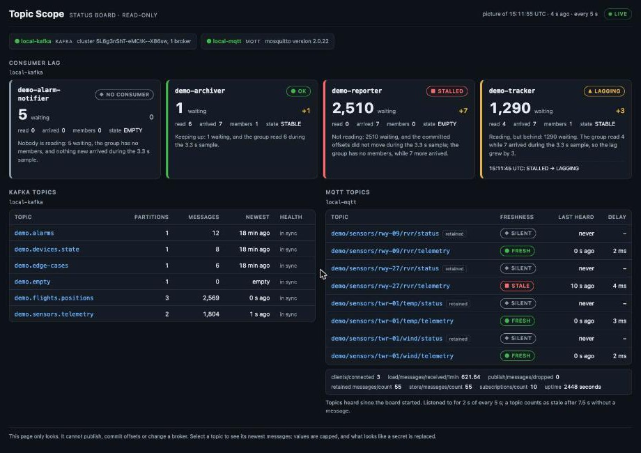

# Topic Scope MCP 0.1.0

The first release: a read-only MCP server that lets an AI assistant look inside Kafka and MQTT brokers.

During development, a test or an incident in a messaging system, the first questions are always the same. Is the topic there? What is actually flowing? Is anyone falling behind? Topic Scope answers them as MCP tools, so an assistant such as Claude Code can fetch the answers while it helps you, and it cannot change anything while it does.



## What is in it

- **Seven tools**: `list_sources`, `list_topics`, `describe_topic`, `recent_messages`, `list_consumer_groups`, `consumer_lag`, `topic_freshness`. They cover the three views (topic list, recent messages, lag) for Kafka and for MQTT.
- **Lag that tells slow from stopped.** `consumer_lag` looks twice and reports `OK`, `LAGGING`, `STALLED` or `NO_CONSUMER` with a one-sentence summary. For MQTT, which has no offsets, `topic_freshness` reports `FRESH`, `STALE` or `SILENT`.
- **Three ways to run it**: MCP over stdin/stdout, MCP over Streamable HTTP with a required token, and a web status board fed over a WebSocket.
- **A local stack** with demo data known in advance, a consumer that falls behind, one that has stopped, and a sensor that falls silent, so every status can be seen without a real system.
- **A Docker image** for all three modes.

## Built for safety-critical surroundings

- The server cannot publish, commit offsets, join a consumer group or change a broker. The build fails if its code could.
- In the local stack the server logs in with an account that the brokers themselves keep from writing, and a test tries to write with it.
- Message values are capped and secret-looking content is redacted.
- Topic allow and deny lists, and an audit log of every call that never holds message content.

## Get it

There is no download yet. Build from source:

```bash
git clone https://github.com/Trapa-Eureka/topic-scope-mcp.git
cd topic-scope-mcp
./mvnw -DskipTests install                  # server/target/topic-scope-server-0.1.0.jar
docker build -t topic-scope-mcp:0.1.0 .     # or the image
docker compose up -d --build --wait         # brokers to try it on
```

Then follow the [usage guide](../usage.md) ([한국어](../usage.ko.md)).

## What was tried, and what was not

Tried: all tools against Kafka 4.3 and Mosquitto 2.0 in Docker (56 integration tests and 94 unit tests); Claude Code as the client over stdin/stdout; the status board in Chrome; the Docker image in all three modes; SASL/PLAIN on Kafka and user name with password on MQTT.

Not tried: TLS, SCRAM and `ssl://` against a real broker; Claude Desktop or any other client; HTTP mode with an assistant as the client; brokers other than Apache Kafka and Mosquitto; Windows.

The full list of limits is in the [changelog](../../CHANGELOG.md#010---2026-11-16) and in [SECURITY.md](../../SECURITY.md).

## Requirements

Java 21 to run the jar, or Docker to run the image. Docker for the local stack and the integration tests. Node.js 20 or newer to build the status board's page from source.
