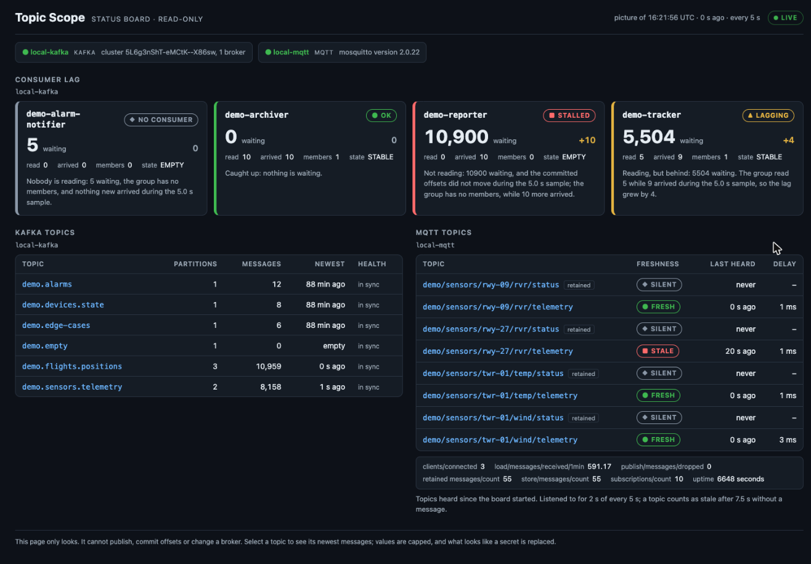

# Topic Scope MCP 0.1.1

A small release, one day after the first. Everything in it was found by using 0.1.0 the way a user would: asking an assistant real questions and watching the status board, instead of running tests.



## What changed

**An assistant no longer mistakes UTC for a broken clock.** The tools report every time in UTC. An assistant working in a time zone that was already on the next calendar day compared those timestamps with its local date and reported that "the broker's clock is a day off". Nothing was wrong with any clock. `list_sources`, the first tool every conversation calls, now also returns the current time in UTC with a sentence on how to read the times, and the server's instructions say the same. Asked again, six conversations out of six no longer made the mistake.

**MQTT messages on the status board.** Selecting an MQTT topic on the board showed "No messages" for a sensor that reports every two seconds, because the board listened for one second. A broker keeps no history, so the board now keeps its own: it shows the newest messages it has heard on that topic since it started.

**No more "changed to MEASURING".** After the server restarted, every consumer group card noted a change to `MEASURING`. That is the server saying it does not know yet, not something the group did. It is no longer recorded.

## New: a walkthrough

[`docs/walkthrough.md`](../walkthrough.md) ([한국어](../walkthrough.ko.md)) goes through Topic Scope once, step by step, on the brokers that come with the repository: starting them, connecting Claude Code, five questions with the answers that came back, and the status board in four pictures.

## Now tried

Two things the 0.1.0 notes listed as not tried have been tried since, with Claude Code 2.1.325:

- **HTTP mode** with an assistant as the client: connected, seven tools, tool calls answered and recorded; refused with a wrong token.
- **The Docker image** registered as an MCP server: Claude Code started the container, used the tools, and the container was gone when the session ended.

The [usage guide](../usage.md) shows the configuration for both.

## Upgrading from 0.1.0

Nothing was removed or renamed. The result of `list_sources` has two new fields, `currentTimeUtc` and `note`. The jar is now `topic-scope-server-0.1.1.jar` and the image `topic-scope-mcp:0.1.1`: update the path or tag where you registered the server, and restart your MCP client.

```bash
git pull
./mvnw -DskipTests install                  # server/target/topic-scope-server-0.1.1.jar
docker build -t topic-scope-mcp:0.1.1 .     # or the image
```

## Still not tried

TLS, SCRAM and `ssl://` against a real broker; Claude Desktop or any client other than Claude Code; brokers other than Apache Kafka and Mosquitto; Windows. The full list is in the README under [Known limitations](../../README.md#known-limitations).

Details of every change are in the [changelog](../../CHANGELOG.md#011---2026-11-17).
