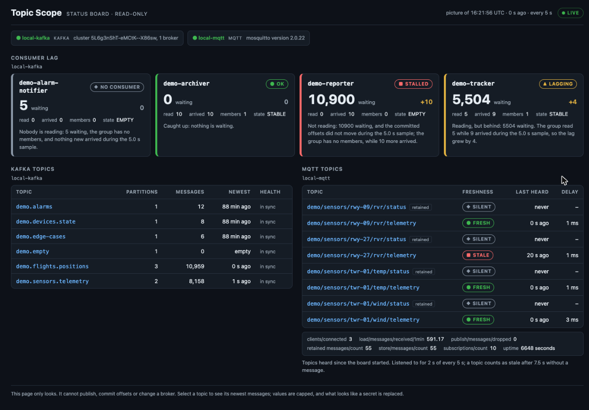
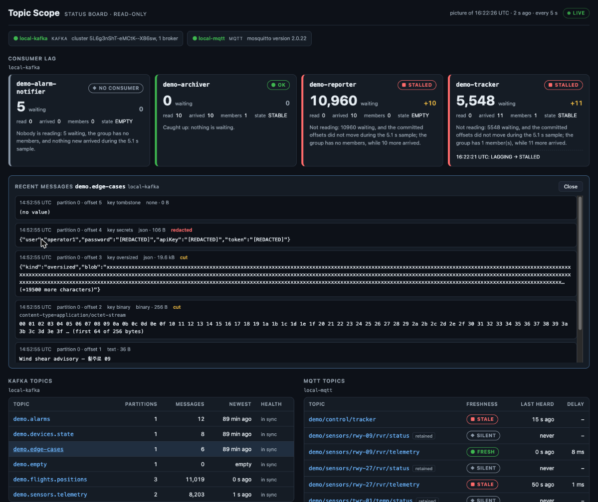
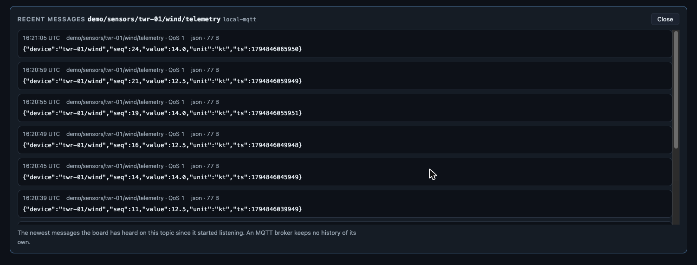
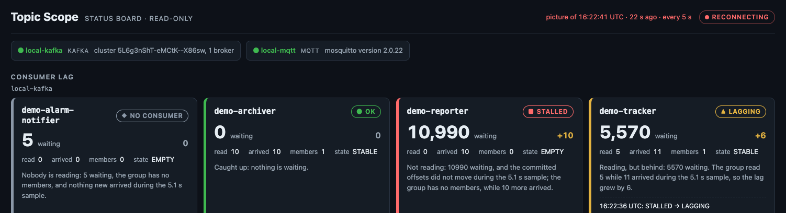

# 따라 하기: 처음부터 답을 얻기까지

English: [walkthrough.md](walkthrough.md)

저장소에 들어 있는 브로커로 Topic Scope를 처음부터 끝까지 한 번 써 보는 문서입니다. 10분쯤 걸리고, 대부분은 첫 빌드를 기다리는 시간입니다. 여기 실린 출력은 모두 실제로 실행해 얻은 것입니다. 숫자와 어시스턴트의 표현은 실행할 때마다 달라집니다.

모든 모드와 설정, 내 브로커에 연결하는 방법 같은 참고 자료는 [사용 가이드](usage.ko.md)에 있습니다.

**순서:** [1. 브로커 띄우기](#1-브로커-띄우기) · [2. 서버 빌드](#2-서버-빌드) · [3. Claude Code 연결](#3-claude-code-연결) · [4. 질문하기](#4-질문하기) · [5. 상태판 열기](#5-상태판-열기) · [6. 상태가 바뀌는 것 보기](#6-상태가-바뀌는-것-보기) · [7. 메시지 보기](#7-메시지-보기) · [8. 기록 확인](#8-기록-확인) · [9. 전부 내리기](#9-전부-내리기)

## 준비물

- 실행 중인 Docker
- Java 21
- 3, 4단계에는 Claude Code. 상태판(5~7단계)은 브라우저만 있으면 됩니다.

```bash
git clone https://github.com/Trapa-Eureka/topic-scope-mcp.git
cd topic-scope-mcp
```

## 1. 브로커 띄우기

```bash
docker compose --profile board up -d --build --wait
```

Kafka, Mosquitto, 데이터를 채우는 시뮬레이터, 상태판이 뜹니다. 처음에는 이미지 두 개를 빌드하느라 몇 분 걸립니다. 시뮬레이터가 한 일을 확인합니다.

```bash
docker compose logs simulator
```

```
[simulator] seeded:
[simulator]   topic demo.flights.positions  partitions=3  records=300
[simulator]   topic demo.sensors.telemetry  partitions=2  records=40
[simulator]   topic demo.alarms  partitions=1  records=12
[simulator]   topic demo.edge-cases  partitions=1  records=6
[simulator]   topic demo.empty  partitions=1  records=0
[simulator]   topic demo.devices.state  partitions=1  records=8
[simulator]   group demo-archiver  topic=demo.flights.positions  lag=0
[simulator]   group demo-tracker  topic=demo.flights.positions  lag=120
[simulator]   group demo-reporter  topic=demo.flights.positions  lag=240
[simulator]   group demo-alarm-notifier  topic=demo.alarms  lag=5
[simulator]   mqtt  4 retained status messages under demo/sensors/
[simulator]   kafka user topicscope may describe and read, and nothing else
[simulator] live traffic running. rwy-27/rvr falls silent after 60 s
```

이제 이 컴퓨터 안에서만 접근할 수 있는 브로커 두 개가 있습니다.

| | 안에서 일어나는 일 |
|---|---|
| Kafka, `localhost:9092` | 항공기 위치가 1초에 두 건씩 들어옵니다. 컨슈머 하나는 따라가고, 하나는 너무 느리게 읽고, 하나는 멈췄고, 하나는 작은 밀린 분량을 남겨 두었습니다 |
| Mosquitto, `localhost:1883` | 센서 네 개가 2초마다 보고합니다. 그중 하나는 1분 뒤 조용해집니다 |

두 브로커 모두 로그인을 요구합니다. 서버는 `topicscope` 계정으로 접속하고, 이 계정은 브로커가 직접 쓰기를 막습니다.

## 2. 서버 빌드

```bash
./mvnw -DskipTests install
```

`server/target/topic-scope-server-0.1.1.jar`가 만들어집니다. 처음에는 의존성을 내려받습니다.

## 3. Claude Code 연결

저장소에 이 폴더용으로 서버를 등록하는 [`.mcp.json`](../.mcp.json)이 들어 있습니다. 여기서 Claude Code를 시작합니다.

```bash
claude
```

새 MCP 서버 `topic-scope`를 쓸지 묻습니다.

```
1. Use this MCP server
2. Use this and all future MCP servers in this project
3. Continue without using this MCP server
```

**1번**을 고릅니다. (2번은 나중에 `.mcp.json`에 추가되는 서버까지 묻지 않고 승인합니다.) 그다음 `/mcp`를 입력하면 `topic-scope`가 연결됨으로 나옵니다. 목록이 길면 맨 끝에 있습니다.

## 4. 질문하기

도구를 직접 호출하지 않습니다. 평소 말로 물으면 어시스턴트가 도구를 고릅니다. 아래는 질문 다섯 개와 그 질문이 이어진 도구, 그리고 돌아온 답입니다. Claude Code 2.1.325로, 로컬 스택을 띄운 지 80분쯤 지났을 때 얻었습니다. 긴 답은 `[...]`로 표시한 곳을 줄였습니다.

### "어떤 브로커가 보여?"

도구: `list_sources`

> 설정된 브로커는 2개이고, 둘 다 현재 응답합니다.
>
> | 이름 | 종류 | 주소 | 상태 | 응답 시간 |
> |---|---|---|---|---|
> | `local-kafka` | Kafka | `localhost:9092` | 연결됨 (클러스터 1개, 브로커 1대) | 약 239ms |
> | `local-mqtt` | MQTT | `tcp://localhost:1883` | 연결됨 (mosquitto 2.0.22) | 약 371ms |
>
> topic-scope는 읽기 전용이라 이 브로커들에 메시지를 발행하거나 오프셋을 바꾸지는 않습니다. [...]

### "local-kafka에 어떤 토픽이 있고, 메시지가 들어오고 있어?"

도구: `list_sources`, `list_topics`, `topic_freshness`

> `local-kafka`(localhost:9092, 브로커 1개)에는 토픽 6개가 있고, 그중 2개에서 지금도 메시지가 들어오고 있습니다. 조회 시점은 2026-11-16 16:13 UTC입니다.
>
> | 토픽 | 파티션 | 보관 메시지 수 | 마지막 메시지 | 상태 |
> |---|---|---|---|---|
> | `demo.flights.positions` | 3 | 9,930 | 방금 (0초 전) | **FRESH** |
> | `demo.sensors.telemetry` | 2 | 7,354 | 1초 전 | **FRESH** |
> | `demo.alarms` | 1 | 12 | 약 1시간 20분 전 | STALE |
> | `demo.devices.state` | 1 | 8 | 약 1시간 20분 전 | STALE |
> | `demo.edge-cases` | 1 | 6 | 약 1시간 20분 전 | STALE |
> | `demo.empty` | 1 | 0 | 없음 | SILENT |
>
> - 현재 메시지가 들어오는 토픽은 `demo.flights.positions`와 `demo.sensors.telemetry`입니다. 기준은 expectedInterval 60초로 확인했습니다.
> - `demo.alarms`, `demo.devices.state`, `demo.edge-cases`는 모두 같은 시각(2026-11-16 14:52:55Z)에 마지막 메시지가 왔고 그 뒤로는 멈춰 있습니다. 데모용 고정 데이터일 가능성이 높습니다.
> - `demo.empty`는 메시지가 한 번도 없는 토픽입니다.
> - 모든 파티션은 복제 이상 없이 정상입니다. [...]

"기준은 60초"라는 문장에 주목하십시오. `STALE`은 주어진 주기에 비춰 판단합니다. "2초마다 보고해야 해"라고 말하면 어시스턴트가 그 값을 넘깁니다.

### "demo-tracker가 잘 따라가고 있어?"

도구: `list_sources`, `list_consumer_groups`, `consumer_lag`(10초 샘플), `list_topics`

> **아니요, demo-tracker는 지금 잘 따라가지 못하고 있습니다.** 연결은 살아 있지만 뒤처지고 있습니다.
>
> - **상태:** 그룹 `demo-tracker`는 STABLE이고 컨슈머 1개가 붙어 있습니다. 그런데 lag 상태는 **LAGGING**입니다.
> - **밀린 양:** `demo.flights.positions` 토픽에 메시지 **5,001개**가 처리되기를 기다리고 있습니다.
> - **속도:** 10초 샘플에서 10개를 읽는 동안 20개가 새로 들어왔습니다. 읽는 속도가 들어오는 속도의 절반이라서 lag이 계속 늘고 있습니다.
> - **가장 오래된 미처리 메시지:** 약 57분(3,422초) 전 것입니다. [...]
>
> 이 도구는 읽기 전용이라 그룹이나 오프셋은 건드리지 않았습니다. 10초 샘플 한 번으로 본 결과이므로, 더 정확히 보려면 샘플 시간을 늘려 다시 확인할 수 있습니다. [...]

이 답은 10초 남짓 걸립니다. 도구가 그룹을 두 번 보고 비교하기 때문입니다. 그래서 "랙이 있다"가 아니라 "읽고는 있는데 너무 느리다"고 말할 수 있습니다. 같은 질문을 `demo-reporter`(멈췄음: `STALLED`)와 `demo-archiver`(따라감: `OK`)에도 해 보십시오.

### "local-mqtt의 센서들이 아직 2초마다 보고하고 있어?"

도구: `list_sources`, `topic_freshness`(10초간 듣기)

> 네, 아직 2초 주기로 보고하고 있습니다. `local-mqtt`를 10초 동안 관찰했고, 텔레메트리 토픽 3개가 모두 FRESH였습니다.
>
> | 토픽 | 상태 | 10초간 메시지 수 |
> |---|---|---|
> | `demo/sensors/rwy-09/rvr/telemetry` | FRESH | 5 |
> | `demo/sensors/twr-01/temp/telemetry` | FRESH | 5 |
> | `demo/sensors/twr-01/wind/telemetry` | FRESH | 5 |
>
> 10초에 5건이면 2초 간격입니다. 마지막 메시지는 관찰 시점에 도착했고 브로커 전달 지연은 8–9ms였습니다. [...]
>
> 참고로 `rwy-27/rvr/telemetry`는 목록에 없습니다. 와일드카드 조회에서는 침묵하던 토픽이 아예 빠지기 때문에, 이 센서가 꺼졌는지 확인하려면 토픽명을 정확히 지정해 다시 조회해야 합니다.

센서는 네 개인데 답에는 세 개만 있습니다. 네 번째인 `rwy-27/rvr`는 오래전에 조용해졌고, MQTT 브로커는 조용한 토픽에 대한 기록을 갖고 있지 않아서 목록에 올릴 것이 없습니다. 어시스턴트가 마지막 문단에서 직접 설명한 그대로입니다. 그 센서 하나를 물으려면 토픽 이름을 댑니다: "`demo/sensors/rwy-27/rvr/telemetry`가 아직 보고하고 있어?" 그러면 `SILENT`라는 답이 옵니다. 5단계의 상태판은 한 번 들은 토픽을 기억하므로 이 부분을 더 잘 보여 줍니다.

### "demo.edge-cases의 마지막 메시지 3개 보여 줘."

도구: `list_sources`, `recent_messages`

> `demo.edge-cases`의 마지막 메시지 3개입니다 (`local-kafka`, 파티션 0, 최신순):
>
> | offset | key | 시각 (UTC) | 값 |
> |---|---|---|---|
> | 5 | `tombstone` | 2026-11-16 14:52:55.054 | 없음 (tombstone, 0 bytes) |
> | 4 | `secrets` | 2026-11-16 14:52:55.054 | `{"user":"operator1","password":"[REDACTED]","apiKey":"[REDACTED]","token":"[REDACTED]"}` (106 bytes) |
> | 3 | `oversized` | 2026-11-16 14:52:55.054 | `{"kind":"oversized","blob":"xxxx…"}` (약 20,030 bytes, 잘림) |
>
> - offset 5는 값이 없는 tombstone입니다.
> - offset 4의 비밀 값은 MCP 도구가 자동으로 마스킹한 결과이며, 원본은 확인하지 않았습니다.
> - offset 3은 길이가 커서 `blob` 필드가 잘린 상태로 반환됐습니다.
> - 헤더는 세 메시지 모두 비어 있습니다.

이 토픽에는 까다로운 레코드가 종류별로 하나씩 일부러 들어 있습니다. 중요한 점은 어시스턴트가 비밀번호, 키, 토큰을 받은 적이 없고 20 kB짜리 값도 받은 적이 없다는 것입니다. 서버를 떠나기 전에 서버 안에서 바뀌고 잘렸습니다.

이 메시지들을 읽으면서 컨슈머 그룹에 가입하지도, 오프셋을 커밋하지도 않았습니다. `demo-tracker`를 비롯한 컨슈머들은 영향을 받지 않았습니다.

## 5. 상태판 열기

http://127.0.0.1:8090 을 엽니다. (1단계에서 함께 띄웠습니다. Docker 없이 상태판을 띄우는 방법은 [사용 가이드](usage.ko.md#상태판)에 있습니다.)



위에서 아래로:

- **오른쪽 위**: 화면이 찍힌 시각, 얼마나 지났는지, 그리고 페이지가 연결돼 있는 동안 `LIVE`. 새 화면은 5초마다 저절로 도착하고, 페이지를 새로 고치지 않습니다.
- **소스**: 브로커 두 개와 각자 알려 온 정보. 응답하지 않는 브로커는 여기서 빨갛게 바뀝니다.
- **Consumer lag**: 그룹마다 카드 하나. 큰 숫자는 대기 중인 메시지 수, 오른쪽 숫자는 직전 화면 이후의 변화입니다. `read`와 `arrived`는 그동안 읽은 수와 들어온 수입니다. 데모 그룹 네 개가 네 가지 상태를 하나씩 보여 줍니다.

  | 카드 | 상태 | 이유 |
  |---|---|---|
  | `demo-archiver` | `OK` | 들어오는 속도만큼 읽음 |
  | `demo-tracker` | `LAGGING` | 읽고는 있지만 들어오는 양의 절반만 읽음 |
  | `demo-reporter` | `STALLED` | 메시지가 쌓이는데 읽지 않음 |
  | `demo-alarm-notifier` | `NO CONSUMER` | 아무 일도 없는 토픽에 밀린 분량이 있고, 접속한 컨슈머가 없음 |

- **Kafka topics**: 파티션 수, 보관 메시지 수, 최신 메시지의 나이.
- **MQTT topics**: 계속 보고하는 토픽은 `FRESH`. 그림에서 `rwy-27/rvr/telemetry`는 `STALE`입니다. 상태판이 앞서 들은 적이 있고, 20초째 조용합니다. `status` 토픽들은 `retained` 표시와 함께 `SILENT`입니다. 브로커가 저장된 메시지를 하나씩 갖고 있을 뿐 새로 발행되는 것은 없습니다.

상태마다 색뿐 아니라 고유한 모양이 있어서, 색을 구분하지 못해도 읽을 수 있습니다.

## 6. 상태가 바뀌는 것 보기

로컬 스택에는 느린 컨슈머가 접속은 유지한 채 읽기를 멈추게 하는 스위치가 있습니다. 상태판을 보면서 실행합니다.

```bash
docker compose exec -T mosquitto mosquitto_pub -h localhost -u simulator -P simulator-local-only -t demo/control/tracker -m stop
```

화면 두 번, 약 10초 안에 `demo-tracker` 카드가 빨갛게 바뀝니다.



카드가 `STALLED`로 바뀌었고, 요약 문장이 이유를 설명하며("커밋 오프셋이 움직이지 않았다 ... 멤버는 1명, 그동안 11건이 더 도착"), 맨 아래 줄에 변경 기록이 남습니다: `16:22:21 UTC: LAGGING → STALLED`. 아무것도 누르지 않았고 페이지를 새로 고치지도 않았습니다. 서버가 밀어 준 것입니다.

다시 읽게 합니다.

```bash
docker compose exec -T mosquitto mosquitto_pub -h localhost -u simulator -P simulator-local-only -t demo/control/tracker -m start
```

(이 스위치 자체가 MQTT 메시지라서, 실행한 뒤에는 MQTT 토픽 목록에 `demo/control/tracker`가 나타납니다.)

## 7. 메시지 보기

어느 표에서든 토픽 이름을 누르면 표 위에 최근 메시지가 열립니다. 다시 누르거나 Close를 누르면 닫힙니다.

Kafka 토픽은 그 자리에서 읽습니다. 6단계의 그림에 `demo.edge-cases`가 보입니다. 값이 없는 레코드, 비밀값이 `redacted`로 표시된 레코드, `cut`으로 표시된 20 kB 레코드, hex로 표시된 바이너리 레코드입니다.

MQTT 토픽은 그 자리에서 읽을 수 없습니다. 브로커가 이력을 보관하지 않기 때문입니다. 상태판은 시작한 이후 그 토픽에서 들은 것을 보여 줍니다.



측정값이 연속적이지 않습니다(`seq` 24, 21, 19, ...). 상태판은 5초 중 2초만 듣기 때문에 일부만 듣습니다. 흐르는 내용을 들여다보는 화면이지, 전부를 기록하는 장치가 아닙니다.

서버가 사라지면 페이지가 그 사실을 알리고, 마지막 화면을 남겨 둔 채 경과 시간을 빨갛게 표시합니다. 서버가 돌아오면 스스로 다시 연결합니다.



## 8. 기록 확인

도구 호출과 상태판에서 연 토픽은 모두 한 줄씩 남습니다. Claude Code가 띄운 서버의 기록은 다음과 같이 봅니다.

```bash
tail -3 ~/.topic-scope/audit.jsonl
```

```json
{"time":"2026-11-16T16:13:16.420045Z","tool":"list_sources","arguments":{},"outcome":"ok","millis":452}
{"time":"2026-11-16T16:13:28.471463Z","tool":"consumer_lag","arguments":{"source":"local-kafka","group":"demo-tracker","sampleSeconds":10},"outcome":"ok","millis":10794}
```

무엇을 물었고 어떻게 끝났는지가 남습니다. 무엇을 답했는지는 남지 않습니다. 이 파일에는 메시지 값이 하나도 없습니다. 컨테이너로 띄운 상태판은 자기 로그를 `/data/audit.jsonl`에 따로 둡니다.

```bash
docker compose --profile board exec board cat /data/audit.jsonl
```

## 9. 전부 내리기

```bash
docker compose --profile board down -v
```

컨테이너를 멈추고 데이터를 지웁니다. Claude Code는 종료해도 되고 그대로 둬도 됩니다. Claude Code가 띄운 서버는 Claude Code와 함께 끝납니다.

## 다음에 볼 것

- **내 브로커**, 로그인, TLS, 보여 줄 토픽 지정: [사용 가이드, "내 브로커에 연결하기"](usage.ko.md#내-브로커에-연결하기).
- **자식 프로세스 없이**, 토큰을 쓰는 HTTP로: [사용 가이드, "HTTP MCP"](usage.ko.md#http-mcp).
- **각 열과 상태의 정확한 의미**: [README, "What it shows"](../README.md#what-it-shows).
- **보장하는 것과 보장하지 않는 것**: [SECURITY.md](../SECURITY.md).
