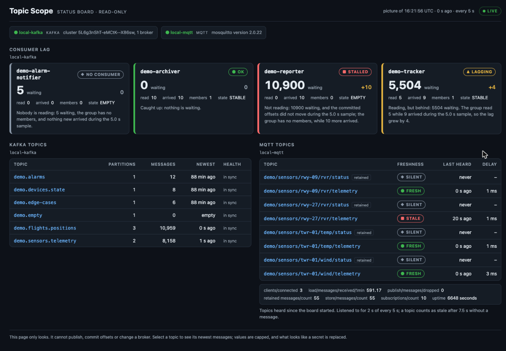
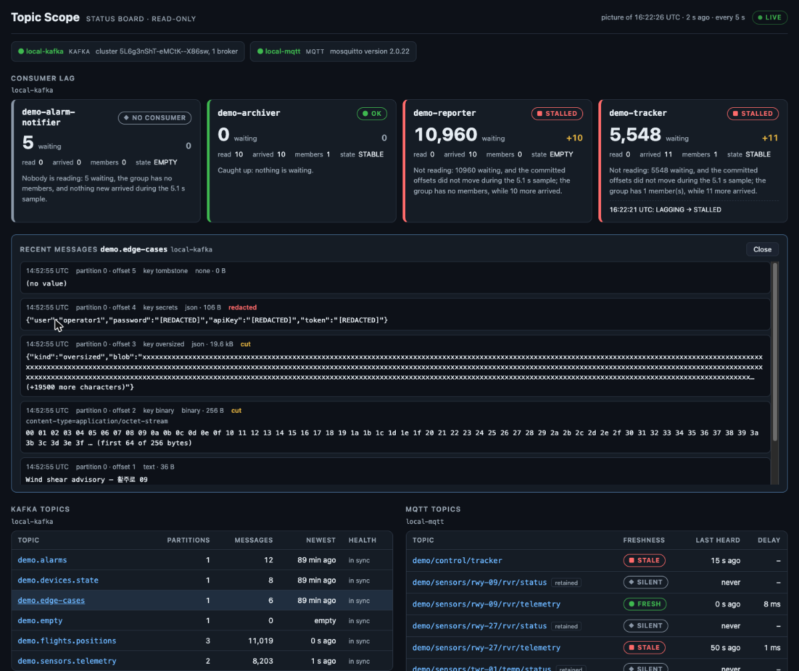
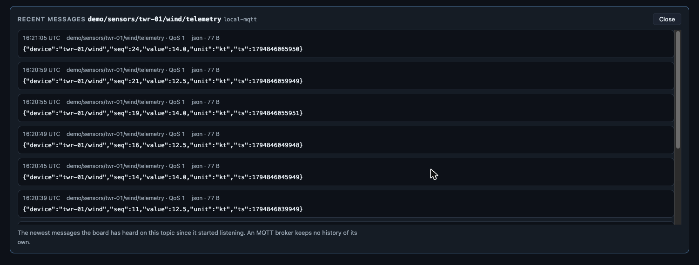
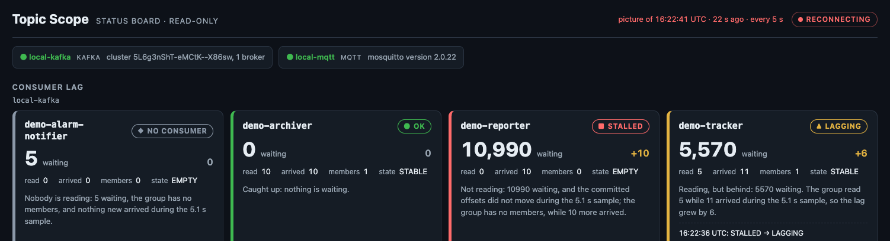

# Walkthrough: from nothing to answers

한국어: [walkthrough.ko.md](walkthrough.ko.md)

This page goes through Topic Scope once, step by step, on the brokers that come with the repository. It takes about ten minutes, most of it waiting for the first build. Everything shown here is real output from such a run; your numbers and the assistant's wording will differ.

For the reference (every mode, every setting, your own brokers) see the [usage guide](usage.md).

**Steps:** [1. Start the brokers](#1-start-the-brokers) · [2. Build the server](#2-build-the-server) · [3. Connect Claude Code](#3-connect-claude-code) · [4. Ask](#4-ask) · [5. Open the status board](#5-open-the-status-board) · [6. Watch a status change](#6-watch-a-status-change) · [7. Look at messages](#7-look-at-messages) · [8. See what was recorded](#8-see-what-was-recorded) · [9. Stop everything](#9-stop-everything)

## What you need

- Docker, running
- Java 21
- Claude Code, for steps 3 and 4. The status board (steps 5 to 7) needs only a browser.

```bash
git clone https://github.com/Trapa-Eureka/topic-scope-mcp.git
cd topic-scope-mcp
```

## 1. Start the brokers

```bash
docker compose --profile board up -d --build --wait
```

This starts Kafka, Mosquitto, a simulator that fills them, and the status board. The first run builds two images and takes several minutes. Check what the simulator did:

```bash
docker compose logs simulator
```

```
[simulator] seeded:
[simulator]   topic demo.flights.positions  partitions=3  records=300
[simulator]   topic demo.sensors.telemetry  partitions=2  records=40
[simulator]   topic demo.alarms  partitions=1  records=12
[simulator]   topic demo.edge-cases  partitions=1  records=6
[simulator]   topic demo.empty  partitions=1  records=0
[simulator]   topic demo.devices.state  partitions=1  records=8
[simulator]   group demo-archiver  topic=demo.flights.positions  lag=0
[simulator]   group demo-tracker  topic=demo.flights.positions  lag=120
[simulator]   group demo-reporter  topic=demo.flights.positions  lag=240
[simulator]   group demo-alarm-notifier  topic=demo.alarms  lag=5
[simulator]   mqtt  4 retained status messages under demo/sensors/
[simulator]   kafka user topicscope may describe and read, and nothing else
[simulator] live traffic running. rwy-27/rvr falls silent after 60 s
```

What you now have, on this machine only:

| | What happens in it |
|---|---|
| Kafka, `localhost:9092` | Aircraft positions arrive twice a second. One consumer keeps up, one reads too slowly, one has stopped, and one left a small backlog behind |
| Mosquitto, `localhost:1883` | Four sensors report every two seconds. One of them falls silent after a minute |

Both brokers ask for a login. The server logs in as `topicscope`, an account that the brokers themselves keep from writing.

## 2. Build the server

```bash
./mvnw -DskipTests install
```

This makes `server/target/topic-scope-server-0.1.0.jar`. The first run downloads dependencies.

## 3. Connect Claude Code

The repository has a [`.mcp.json`](../.mcp.json) that registers the server for this folder. Start Claude Code here:

```bash
claude
```

It asks whether to use the new MCP server `topic-scope`:

```
1. Use this MCP server
2. Use this and all future MCP servers in this project
3. Continue without using this MCP server
```

Choose **1**. (Option 2 would also approve any server that is added to `.mcp.json` later, without asking.) Then type `/mcp`: `topic-scope` is listed as connected. The list can be long; it is at the end.

## 4. Ask

You do not call the tools. You ask in your own words, and the assistant chooses. Below are five questions with the tools they led to and the answers that came back, from Claude Code 2.1.325 on the local stack about 80 minutes after it was started. Long answers are shortened where marked with `[...]`.

### "Which brokers can you see?"

Tool: `list_sources`

> I can see two brokers, and both are reachable right now:
>
> | Name | Type | Address | Status |
> |---|---|---|---|
> | `local-kafka` | Kafka | `localhost:9092` | Reachable, 1 broker (cluster `5L6g3nShT-eMCtK--X86sw`), responded in about 331 ms |
> | `local-mqtt` | MQTT | `tcp://localhost:1883` | Reachable, Mosquitto 2.0.22, responded in about 395 ms |
>
> My access is read-only. I can list topics, describe them, read recent messages, check consumer groups and lag, and check topic freshness. I can't publish, commit offsets or change anything on the brokers.

### "Which topics are on local-kafka, and is anything arriving?"

Tools: `list_sources`, `list_topics`, `topic_freshness`

> **Yes, two topics are receiving messages right now.** The local Kafka broker (`localhost:9092`, one broker, reachable) has six topics:
>
> | Topic | Partitions | Stored messages | Newest message | Status (60s expected interval) |
> |---|---|---|---|---|
> | `demo.flights.positions` | 3 | 9,929 | 0 s ago | FRESH |
> | `demo.sensors.telemetry` | 2 | 7,354 | 1 s ago | FRESH |
> | `demo.alarms` | 1 | 12 | about 80 min ago | STALE |
> | `demo.devices.state` | 1 | 8 | about 80 min ago | STALE |
> | `demo.edge-cases` | 1 | 6 | about 80 min ago | STALE |
> | `demo.empty` | 1 | 0 | none | SILENT |
>
> The three stale topics all stopped at the same time [...] Their message counts are small, so they look like test or seeded data rather than live feeds. None of the topics has under-replicated or offline partitions.
>
> The 60-second interval is my assumption, not a value from your config. If `demo.alarms` or `demo.devices.state` is only expected to send occasionally, those STALE labels may not mean a problem.

The last paragraph is worth noticing: `STALE` is measured against an interval you give. Say "they should report every 2 seconds" and the assistant passes that on.

### "Is demo-tracker keeping up?"

Tools: `list_sources`, `list_consumer_groups`, `consumer_lag` (with a 10-second sample), `topic_freshness`

> **No, demo-tracker is falling behind.** It's still consuming, but it reads about half as fast as messages arrive.
>
> - **Status: LAGGING.** The group is STABLE with one member connected. In a 10.2 s sample it read 11 messages while 20 arrived.
> - **Backlog: 4,999 messages** on `demo.flights.positions`, and the lag grew by 9 during the sample.
> - **Oldest unread message is about 57 minutes old** (3,422 s).
> - **Partition 2 is the worst:** committed offset 1037 against end offset 3317, lag 2,280. Partitions 0 and 1 each have about 1,360 waiting. [...]
>
> The growth rate is small, around 1 message per second, but it is positive, so the backlog will not drain at the current speed. The sample is only 10 seconds, so treat the rate as rough. [...]

This answer takes a little over ten seconds, because the tool looks at the group twice and compares. That is how it can say "reading, but too slowly" instead of only "there is a lag". Try the same question about `demo-reporter` (it has stopped: `STALLED`) and `demo-archiver` (it keeps up: `OK`).

### "Are the sensors on local-mqtt still reporting every 2 seconds?"

Tools: `list_sources`, `list_topics`, `topic_freshness` (listening for 12 seconds)

> Yes. The three telemetry sensors on `local-mqtt` are all publishing at about a 2-second interval and are currently fresh.
>
> | Topic | Messages in 12 s | Last message age |
> |---|---|---|
> | `demo/sensors/rwy-09/rvr/telemetry` | 6 | 1 s |
> | `demo/sensors/twr-01/temp/telemetry` | 6 | 1 s |
> | `demo/sensors/twr-01/wind/telemetry` | 6 | 1 s |
>
> Delivery delay is 6–7 ms. The broker is mosquitto 2.0.22 with 3 connected clients and no dropped publishes.
>
> Two things I noticed that you didn't ask about:
> - `demo/sensors/rwy-27/rvr/status` has a retained message but no telemetry was heard in the window. Either that sensor is not publishing, or its telemetry topic is named differently. [...]

There are four sensors and the answer lists three. The fourth, `rwy-27/rvr`, had fallen silent long before, and an MQTT broker keeps no record of a topic that is silent: there is nothing to list. The assistant noticed the gap from the sensor's retained status message. To ask about that one sensor, name its topic: "is `demo/sensors/rwy-27/rvr/telemetry` still reporting?" The answer is then `SILENT`. The status board in step 5 does better here, because it remembers what it has heard.

### "Show me the last 3 messages on demo.edge-cases."

Tools: `list_sources`, `recent_messages`

> The last 3 messages on `demo.edge-cases` (local-kafka, partition 0), newest first:
>
> | Offset | Key | Timestamp (UTC) | Value |
> |---|---|---|---|
> | 5 | `tombstone` | 2026-11-16 14:52:55.054 | none (tombstone, 0 bytes) |
> | 4 | `secrets` | 2026-11-16 14:52:55.054 | `{"user":"operator1","password":"[REDACTED]","apiKey":"[REDACTED]","token":"[REDACTED]"}` (106 bytes, JSON) |
> | 3 | `oversized` | 2026-11-16 14:52:55.054 | `{"kind":"oversized","blob":"xxxx…"}` (20,030 bytes, JSON, truncated) |
>
> - **Offset 5** is a null-value record, which Kafka uses as a delete marker for compacted topics.
> - **Offset 4** has its credential fields redacted by the tool. The `user` value `operator1` was not redacted.
> - **Offset 3** is cut off by the tool, so I can't see the full blob.

This topic holds one awkward record of each kind on purpose. What matters: the assistant never received the password, the key or the token, and never received the 20 kB value. They were replaced and cut in the server, before anything left it.

Reading these messages joined no consumer group and committed no offset. `demo-tracker` and the others were not disturbed.

## 5. Open the status board

Open http://127.0.0.1:8090. (Step 1 started it. Without Docker for the board, see the [usage guide](usage.md#status-board).)



From top to bottom:

- **Top right**: when the picture was taken, how long ago, and `LIVE` while the page is connected. A new picture arrives every 5 seconds by itself; the page is never reloaded.
- **Sources**: the two brokers and what they say about themselves. A broker that does not answer turns red here.
- **Consumer lag**: one card per group. The big number is how many messages are waiting; the number on the right is how that changed since the last picture. `read` and `arrived` say how many the group read and how many came in. The four demo groups show the four statuses:

  | Card | Status | Why |
  |---|---|---|
  | `demo-archiver` | `OK` | reads as fast as messages arrive |
  | `demo-tracker` | `LAGGING` | reads, but only half of what arrives |
  | `demo-reporter` | `STALLED` | messages wait and it does not read |
  | `demo-alarm-notifier` | `NO CONSUMER` | a backlog on a topic where nothing happens, and nobody connected |

- **Kafka topics**: partitions, messages kept, how old the newest one is.
- **MQTT topics**: `FRESH` while a topic keeps reporting. In the picture `rwy-27/rvr/telemetry` is `STALE`: the board heard it earlier, and it has been quiet for 20 seconds. The `status` topics are `SILENT` with the tag `retained`: the broker holds one stored message for each and nothing new is published on them.

Every status has its own shape as well as its own colour, so the board can be read without telling the colours apart.

## 6. Watch a status change

The local stack has a switch that makes the slow consumer stop reading while it stays connected. Keep the board in view and run:

```bash
docker compose exec -T mosquitto mosquitto_pub -h localhost -u simulator -P simulator-local-only -t demo/control/tracker -m stop
```

Within two pictures, about ten seconds, the `demo-tracker` card turns red:



The card now says `STALLED`, its summary explains why ("the committed offsets did not move ... the group has 1 member(s), while 11 more arrived"), and a line at the bottom records the change: `16:22:21 UTC: LAGGING → STALLED`. Nothing was clicked and the page was not reloaded; the server pushed it.

Let it read again:

```bash
docker compose exec -T mosquitto mosquitto_pub -h localhost -u simulator -P simulator-local-only -t demo/control/tracker -m start
```

(The switch is itself an MQTT message, which is why `demo/control/tracker` shows up among the MQTT topics afterwards.)

## 7. Look at messages

Select a topic name in either table and its newest messages open above the tables. Select it again, or press Close, to put them away.

A Kafka topic is read on the spot. The picture in step 6 shows `demo.edge-cases`: the record without a value, the one whose secrets are marked `redacted`, the 20 kB one marked `cut`, and the binary one as a row of hex.

An MQTT topic cannot be read on the spot, because a broker keeps no history. The board shows what it has heard on that topic since it started:



The readings are not consecutive (`seq` 24, 21, 19, ...): the board listens for 2 of every 5 seconds, so it hears some messages and not all. It is a view of what is flowing, not a recording.

If the server goes away, the page says so and keeps the last picture on screen with its age in red. When the server is back, it connects again by itself:



## 8. See what was recorded

Every tool call, and every topic opened on the board, leaves one line. For the server Claude Code started:

```bash
tail -3 ~/.topic-scope/audit.jsonl
```

```json
{"time":"2026-11-16T16:13:16.420045Z","tool":"list_sources","arguments":{},"outcome":"ok","millis":452}
{"time":"2026-11-16T16:13:28.471463Z","tool":"consumer_lag","arguments":{"source":"local-kafka","group":"demo-tracker","sampleSeconds":10},"outcome":"ok","millis":10794}
```

It says what was asked and how it ended. It never holds what was answered: no message value is in this file. The board in the container keeps its own log at `/data/audit.jsonl`:

```bash
docker compose --profile board exec board cat /data/audit.jsonl
```

## 9. Stop everything

```bash
docker compose --profile board down -v
```

This stops the containers and forgets the data. Quit Claude Code, or leave it: the server it started ends with it.

## Where to go from here

- **Your own brokers**, logins, TLS, and which topics may be shown: [usage guide, "Your own brokers"](usage.md#your-own-brokers).
- **Without a child process**, over HTTP with a token: [usage guide, "MCP over HTTP"](usage.md#mcp-over-http).
- **What each column and status means exactly**: [README, "What it shows"](../README.md#what-it-shows).
- **What it promises and what it does not**: [SECURITY.md](../SECURITY.md).
